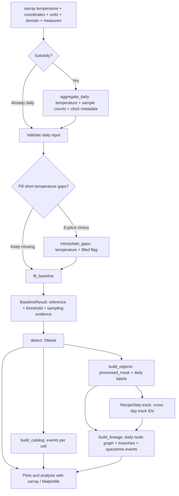

# Processing: from temperature to events

[← Start](GETTING_STARTED.md) · [Index](README.md) · [Baselines →](BASELINES.md)

## Products and routes



No spatial step is required for temporal analysis. Genealogy can also be built
from segmented objects without tracker IDs. It uses a declared overlap policy.

| Stage | Input → operation → output | Choices to declare | Computation |
|---|---|---|---|
| Access | Local NetCDF/Zarr → xarray opening → Dataset | Product/version, variable, subset, retrieval time, checksum, credentials outside repo | I/O; opening is often lazy, `.load()` is not |
| Preparation | Raw samples → inspect/aggregate/reindex → regular daily Dataset | Units, calendar, day clock, statistic, missing timestamps versus observations, domain and measures | Aggregation can stay lazy with Dask; counts are per cell/day |
| Interpolation | Daily temperature → limited interior linear filling → temperature + `filled` | `max_days`, maximum filled fraction | Requires each temporal series; never extrapolates edges |
| Baseline | Reference observations → estimator/decomposition → BaselineResult | Reference period, estimator, leap rule, sample minimum, method and fit availability | Exact percentiles need complete time chunks; dynamic methods add dense time arrays |
| Detection | Temperature + compatible baseline → exceedance and persistence → XMask | Tail, comparator, minimum duration, temporal gaps, join order, missing policy | Per temporal series; masks and diagnostics consume memory |
| Temporal catalog | XMask → enumerate cell runs → EventCatalog | Analysis mode, boundary context and censoring | Materializes event rows |
| Spatial recipe | XMask layer → ordered geometry operations → ObjectField | Input layer, connectivity, area filter, operation order | Eager spatial fields and object tables |
| Tracking | Daily patches → overlap links → track IDs/table | Denominator, inclusive threshold, object gaps, track duration, mode | Eager; cost grows with days, patches and candidate links |
| Genealogy | ObjectField → transitions and groups → LineageGraph | LinkPolicy, analysis mode, merge rule; intensity field and weighting | Eager graph; maps materialize on demand |
| Analysis/plots | Products → summaries/maps/series → tables and graphics | Denominators, physical weights, intensity convention, censoring | Reduce before plotting; no native xHW plotting API |

## Quality before detection

Use `grid.check(ds)` early. Supported daily calendars are `standard`, `gregorian`
and `proleptic_gregorian`, represented by `datetime64`, for dates from 1582-10-15.
Declare the temperature unit (`degC` or `K` and accepted aliases) and keep components
consistent. xHW does not automatically turn Kelvin into Celsius. A temperature
difference of 1 K equals a difference of 1 °C; an absolute temperature does not.

An absent timestamp makes the frequency irregular. A timestamp with `NaN` is a
present daily observation slot whose temperature is unknown. If dates are missing,
reindex deliberately before fitting, preserving NaNs in the inserted slots:

```python
expected_days = np.arange(np.datetime64("1991-01-01"), np.datetime64("2026-01-01"))
ds = ds.reindex(time=expected_days.astype("datetime64[ns]"))
grid.check(ds)
```

This snippet assumes `import numpy as np` and a daily dataset `ds`. Reindexing is a
quality operation, not permission to replace missing temperatures with zeros.
Restrict the domain independently of temperature missingness. A mask can be
static ocean/land support while individual days remain missing.

For AHW, `aggregate_daily` declares both the stamp clock and day clock.
Instantaneous samples belong to `[start, end)`; period-ending extrema use
`(start, end]`. With UTC stamps and `offset:-05:00`, a complete local day of hourly
period-ending data requires the appropriate following-UTC-day boundary samples.
Defaults require all 24 hourly observations per cell; incomplete days become NaN.
The companion `<name>_n_samples` records counts and processing metadata, which
downstream fitting/detection check for consistency. See the
[ERA5 tutorial](https://github.com/DanielCamarena/xhw-benchmark/blob/main/docs/TUTORIALS.md#era5) in xhw-benchmark.

## Three different gap operations

| Operation | Changes | Does not establish |
|---|---|---|
| `interpolate_gaps(..., max_days=2, max_filled_fraction=0.05)` | Interior missing **temperatures**, flagged `filled` | New observed baseline samples; filled days are excluded from quantiles |
| Detector `max_gap_days=2` | **Temporal membership** between already qualifying runs | Exceedance on a cool or missing day |
| Recipe `open`/`close` and connectivity | **Spatial working geometry**, stored separately | An observed temperature or original temporal exceedance on added cells |

A cell exceeding the permitted filled fraction gets quality invalidity. Long or
edge gaps remain missing. Fit/decomposition requirements can reject incomplete
series even when detection could otherwise keep missing observations.

## Read an XMask correctly

| Variable | Meaning |
|---|---|
| `exceedance` | Valid temperature is beyond its threshold under the declared comparator |
| `event_membership` | Day belongs to a qualifying temporal run or an allowed joined gap |
| `joined_gap` | Membership without exceedance; possibly cool, possibly missing |
| `valid` | Temperature, baseline, sample sufficiency and data quality permit interpretation |
| `invalid_reason` | Bit flags: 1 outside domain, 2 missing data, 4 undefined baseline, 8 insufficient samples, 16 low data quality |
| `filled` | Present when interpolation occurred; an estimated observation, not original evidence |
| `temperature`, `reference`, `threshold` | Values on the declared temperature scale; components are explicit for joint AHW |

Invalidity bits can combine; test with bitwise AND, not equality to one code.
A missing day can belong to an allowed joined gap while remaining invalid.
Spatial processing works only on valid cells. Preserve validity when counting
frequency; `false` outside the domain is not an observed absence of an event.


*Synthetic cell, P90 = reference = 20 °C, minimum duration 5, temporal gap limit 2.
January 7 is not an exceedance but belongs to the 13-day event. This is a constructed
illustration with degenerate climatology; categories are disabled.*


*A different cell has one missing interior observation. Its interpolated 25 °C
value is flagged with a diamond and exceeds the threshold; it is not a joined
cool day. The raw line exposes the missing observation.*

`qualify_then_join` first discards runs below the minimum duration, then joins
qualifying runs across permitted gaps. For a five-day minimum, three hot days,
one cool day and three hot days do not create a seven-day event. At an analysis
boundary, censoring describes incomplete context rather than proving a complete
event duration.

## Grids and practical budgets

Detection uses the supplied grid; regridding is not a prerequisite. Spatial
objects support structured lines, surfaces and volumes, including curvilinear
coordinates and static vertical geometry. Unstructured grids and time-dependent
geometry are rejected. Longitude wrapping is opt-in through `periodic_x`.

The examples load deliberately selected cases eagerly: the synthetic Peru field has 640
horizontal cells on 12,784 days. In xhw-benchmark, OISST has 640 cells, ERA5 693, decimated
GLORYS 1,248 possible voxels per day and native OSTIA 16,000 cells, whose run needs about 4 GB
and 13 minutes. Compressed file sizes are not memory budgets. Temperature, baseline, masks,
object fields and checks may coexist; allow several GiB for real data. `check_invariants` and
`check_against` are full numerical checks, not cheap metadata checks. Dask can defer
temporal operations but does not make spatial and graph steps lazy. Avoid applying
`.values` or `.compute()` to an unbounded global dataset.
