# Plotting xHW products

[← Metrics](METRICS.md) · [Index](README.md) · [Tutorials →](TUTORIALS.md)

xHW has no plotting API. Its products are xarray datasets, so they plot with
[xarray](https://docs.xarray.dev/en/stable/user-guide/plotting.html) and Matplotlib.
This page gives:

1. three short recipes you can paste into your own code;
2. the ready-made figure functions in [`examples/plotting.py`](../examples/plotting.py),
   used by every tutorial, with the figure each one produced.

Install Matplotlib with `python -m pip install -r examples/requirements.txt`.

## Set-up for this page

Every block on this page runs from the repository root, on the synthetic tutorial field:

```python
import sys
from pathlib import Path

import matplotlib.pyplot as plt
import numpy as np

import xhw

sys.path.insert(0, "examples")               # the tutorial helpers are not installed
from _data import synthetic_inputs           # noqa: E402

raw, grid, baseline, definition = synthetic_inputs()
prepared = xhw.interpolate_gaps(raw, variable="sst", grid=grid, max_days=2,
                                max_filled_fraction=0.05)
fitted = xhw.fit_baseline(prepared, variable="sst", grid=grid, baseline=baseline,
                          definition=definition)
mask = xhw.detect(prepared, variable="sst", grid=grid, definition=definition,
                  baseline_result=fitted)
recipe = xhw.SpatialRecipe(input_layer="event_membership", steps=(
    xhw.RecipeStep.segment(min_area=xhw.MinArea.none()),
    xhw.RecipeStep.track(min_overlap=0.1, max_gap_days=0, min_duration_days=5),
))
objects = xhw.build_objects(mask, recipe=recipe)
graph = xhw.build_lineage(objects, field=mask.intensity(), weighted=True)
event = int(graph.dataset.event_number.values[np.argmax(graph.dataset.event_area_days.values)])
```

## Recipes

### Event frequency map

Restrict both numerator and denominator to valid cell-days. An invalid cell must stay
blank, not show as a zero frequency.

```python
valid_days = mask.dataset.valid.sum("time")
in_event = (mask.dataset.event_membership & mask.dataset.valid).sum("time")
frequency_pct = 100 * in_event / valid_days.where(valid_days > 0)

frequency_pct.plot(cbar_kwargs={"label": "% of valid days in an event"})
plt.title(f"{definition.phenomenon.upper()} frequency, P{definition.percentile:g}")
plt.close("all")
```

### Temperature, reference and threshold at one cell

The XMask carries `temperature`, `reference` and `threshold` on the same days, so a
time series needs no extra alignment:

```python
cell = mask.dataset.isel(lat=0, lon=0).sel(time=slice("2003-01-01", "2003-01-20"))
fig, ax = plt.subplots(figsize=(8, 3))
cell.temperature.plot(ax=ax, marker="o", label="temperature")
cell.reference.plot(ax=ax, label="reference")
cell.threshold.plot(ax=ax, linestyle="--", label="threshold")
ax.fill_between(cell.time.values, cell.threshold, cell.temperature,
                where=cell.event_membership.values, alpha=0.3, label="event")
ax.legend()
plt.close(fig)
```

### Size and intensity of one spacetime event

`graph.series` returns daily occupied size (m² for surfaces, m³ for volumes) and,
when the graph was built with `field=mask.intensity()`, weighted intensity:

```python
series = graph.series(spacetime_event=event)
fig, (top, bottom) = plt.subplots(2, 1, sharex=True, figsize=(8, 5))
(series.area / 1e6).plot(ax=top)
top.set_ylabel("Occupied area (km²)")
series.intensity_mean.plot(ax=bottom, label="area-weighted mean")
series.intensity_max.plot(ax=bottom, label="maximum")
bottom.set_ylabel(f"Intensity ({mask.dataset.temperature.attrs['units']})")
bottom.legend()
plt.close(fig)
```

## Figure functions in `examples/plotting.py`

Each function takes xHW products, draws a figure and saves `<output_dir>/<name>.png`.
They are example code: copy and adapt them. Import them by putting `examples/` on the path:

```python
import plotting

output = Path("outputs/plotting-guide")
plotting.frequency_figure({"Synthetic MHW": mask}, output)
plotting.series_figure(raw, mask, variable="sst", selection={"lat": 0, "lon": 0},
                       period=("2003-01-01", "2003-01-20"), output_dir=output)
plotting.sequence_figure(objects, ["2003-01-05", "2003-01-06", "2003-01-11"], output)
plotting.genealogy_figure(graph, event, output)
plotting.metrics_figure(graph, objects, event, output)
plt.close("all")
```

| Function | Inputs | Shows |
|---|---|---|
| `series_figure(raw, mask, variable=, selection=, period=, output_dir=)` | Raw dataset, XMask | One cell: temperature, reference, threshold, exceedance/membership/joined-gap flags, filled days |
| `frequency_figure(masks, output_dir)` | `{title: XMask}` | Percentage of valid days in an event, one panel per mask |
| `connectivity_figure(mask, date, output_dir)` | XMask | The same day segmented with rank-1 and rank-2 neighbours |
| `mask_figure(mask, processed, date, output_dir)` | XMask, ObjectField of a morphology recipe | Original membership, processed mask, added and removed cells |
| `sequence_figure(objects, dates, output_dir)` | Tracked ObjectField | Daily labels and track IDs, annotated with their numbers |
| `genealogy_figure(graph, event, output_dir)` | LineageGraph | Branches of one spacetime event; arrows mark splits and merges |
| `metrics_figure(graph, objects, event, output_dir)` | LineageGraph, ObjectField | Occupied size, weighted intensity, occupied days per cell |
| `largest_event(graph)` | LineageGraph | Number of the event with the largest size-time |

## Gallery

Every image below is a saved output of a tutorial. The caption gives the call;
[TUTORIALS](TUTORIALS.md) states the full configuration and review status. The real-data
figures (OISST, OSTIA, ERA5 and GLORYS, including a latitude-depth section of a volume) are in
[xhw-benchmark](https://github.com/DanielCamarena/xhw-benchmark/blob/main/docs/TUTORIALS.md).

### Temperature and detection flags

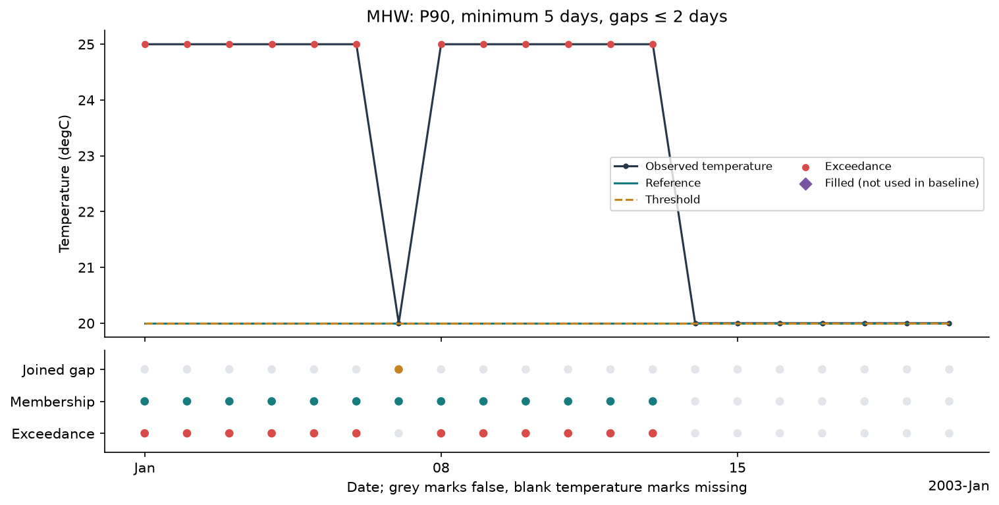

`series_figure(raw, mask, selection={"lat": 0, "lon": 0}, ...)`: synthetic tutorial.
Red dots are exceedances. The cool day of January 7 is a **joined gap**: it is part of
the event but not an exceedance. The lower panel shows each flag day by day.

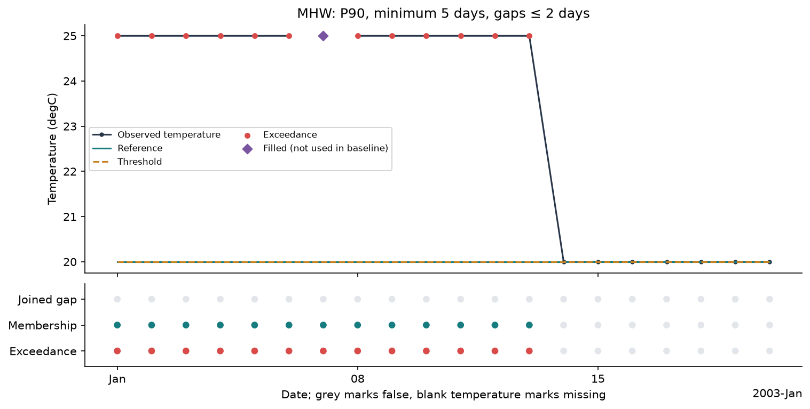

`series_figure(..., selection={"lat": 0, "lon": 8}, name="missing")`. The missing day
was filled by `interpolate_gaps` (diamond); the filled value exceeds the threshold, so
it counts as an exceedance but stays flagged as estimated.

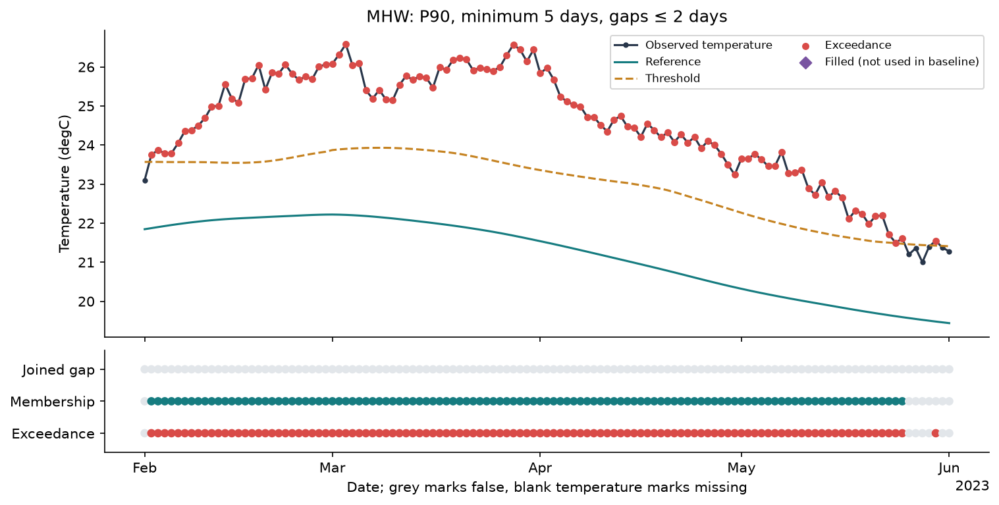

`series_figure` on one cell of the synthetic Peru field, February–June 2023: a seasonal
reference and threshold with daily weather noise around them.

### Frequency maps

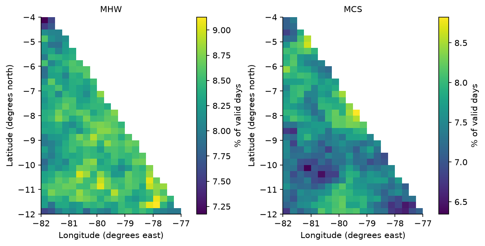

`frequency_figure({"MHW": ..., "MCS": ...})`: percentage of valid days in an event,
1991–2025. Each panel has its own colour scale.

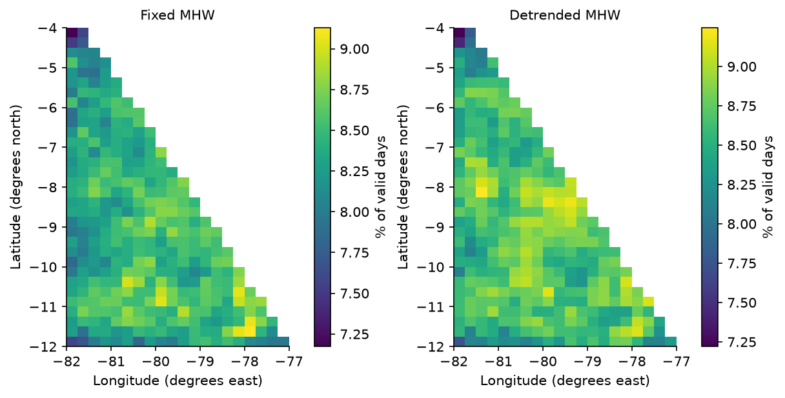

`frequency_figure({"Fixed MHW": ..., "Detrended MHW": ...}, name="baseline_comparison")`:
the same definition with two references. The masks answer different questions; neither is "the correct one".

### Geometry: connectivity and morphology

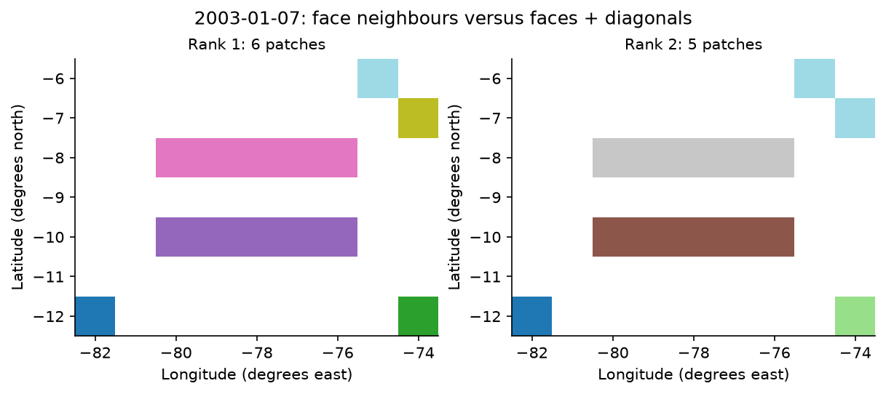

`connectivity_figure(mask, "2003-01-07")`: two cells touching only diagonally are two
patches with rank 1 and one patch with rank 2.

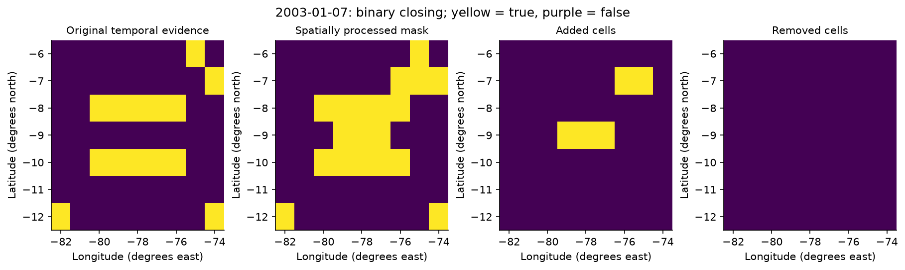

`mask_figure(mask, processed, "2003-01-07")` after `close → segment`. The added cells
are stored in `added`; the original membership is unchanged.

### Labels, tracks and genealogy

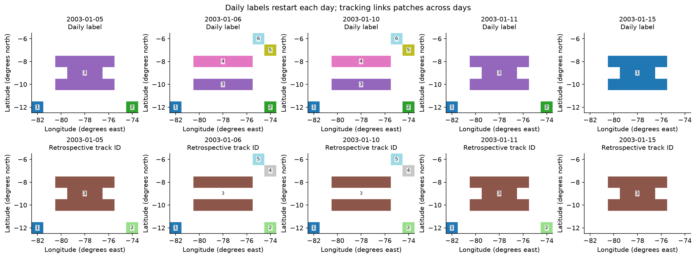

`sequence_figure(objects, dates)`: daily labels restart every day; one track ID follows
the overlapping patches across the split and the merge.

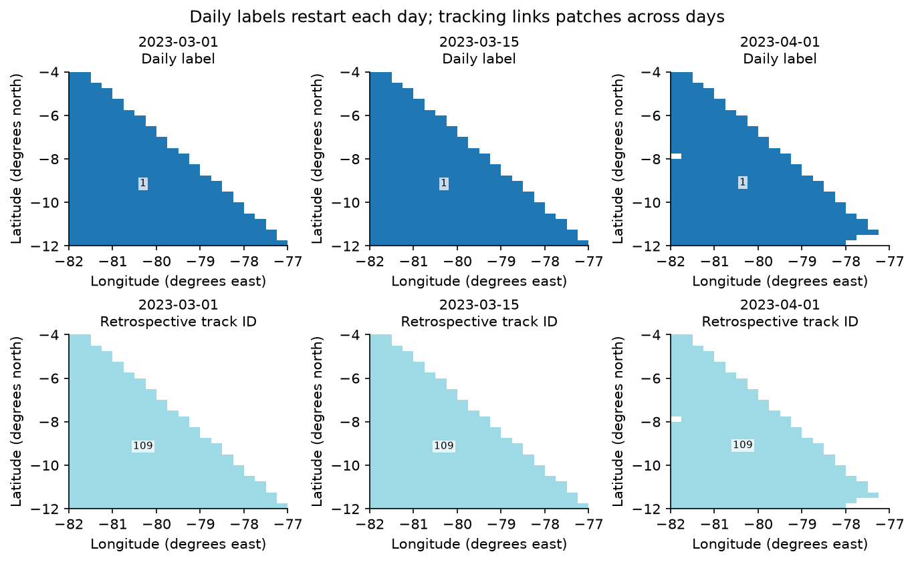

The same function on the synthetic Peru field, March–April 2023.

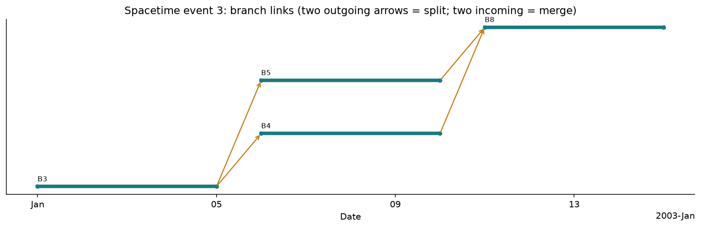

`genealogy_figure(graph, event)`: four branches; two arrows leaving a branch mark a split,
two arriving mark a merge.

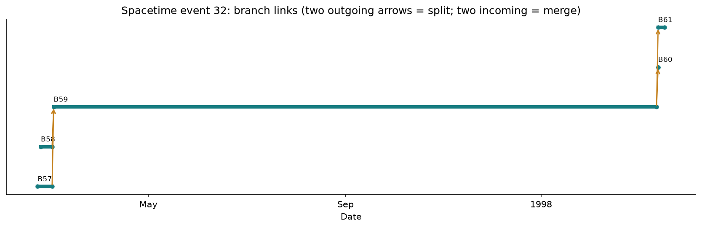

A larger genealogy. When an event has more than 18 branches, only the first 18 are drawn
and the title says so.

### Event metrics

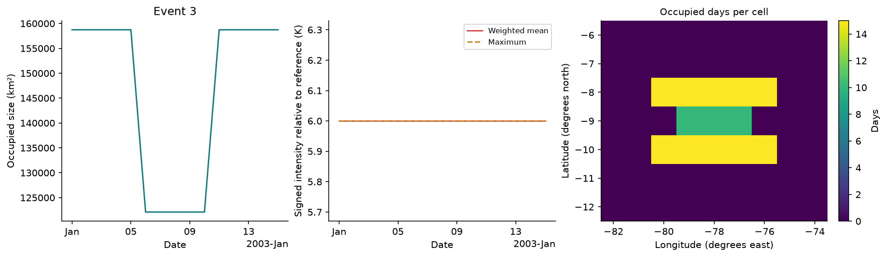

`metrics_figure(graph, objects, event)`: daily occupied area, area-weighted signed
intensity, and the number of occupied days per cell.

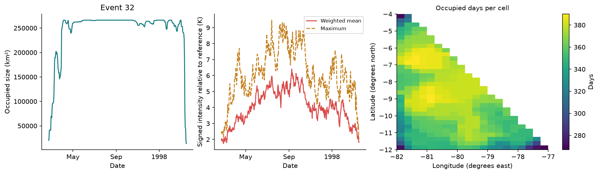

The largest spacetime event of the synthetic Peru field (392 calendar days). The map counts
occupied days of this event, not an annual frequency. For volumes, size is in km³ and
intensity is volume-weighted.

## Good practice

- State the date selection, depth slice, reference period and definition in the title
  or caption.
- Track-ID palettes repeat for many IDs: annotate numbers, as `sequence_figure` does.
- Reduce before plotting (`.sel`, `.isel`, `.sum("time")`); do not call `.values` on an
  unbounded global dataset.
- Intensity is relative to the **reference**, not the threshold. The catalog's
  `*_rel_threshold` fields give the excess over the threshold.

## GIF, 3-D and live notebook exploration

The helpers in examples/plotting.py and examples/exploration.py are local example code,
not xhw plotting API. Install `python -m pip install -r examples/requirements-interactive.txt`.
The public synthetic tutorial produces evolution.gif with the known split and merge.
The companion benchmark's six real-data notebooks have product/date/layer, event/branch and cell controls;
GLORYS adds retained-depth selection, rotatable voxel centres, offline volume.html and
vertical_evolution.gif. The view uses retained cells and explicit dates, without interpolation.

Controls operate on computed products. A disabled event selector indicates a temporal-only
product. GitHub shows the saved static figures; kernel controls require a live Jupyter
environment. Install ipywidgets in the kernel environment (and jupyterlab_widgets in a
separate Lab server environment, if used). Standalone HTML embeds Plotly and works offline.
Large HTML/NetCDF outputs remain local release assets; they are not added to Git.

The default animation selects at most 60 consecutive dates around the chosen event's
size peak. Scales are fixed within an animation. The 3-D display uses longitude/latitude
in degrees and depth in metres, positive down; its visual aspect is not a physical scale.
Decimated GLORYS levels and approximate thickness remain approximation limits.

Map helpers use declared physical coordinates, including auxiliaries; index axes are
labelled as indices. Sequence figures support one date and singleton spatial axes.
The benchmark's `vertical_figure` helper accepts `date`, `variable`,
`longitude_index` and `depth_slice` keyword arguments.

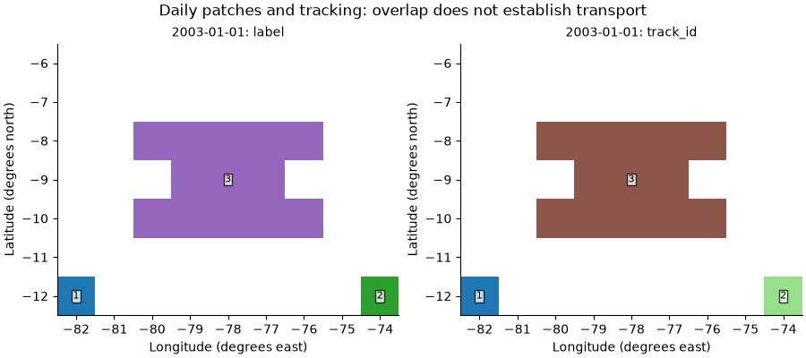

*Synthetic surface, 1–20 January 2003, three frames per second. Daily patch IDs
restart each day; tracker IDs connect qualifying overlap. Colours use one fixed
range per representation, and numerical labels disambiguate repeated colours.
The main event splits on 6 January and merges on 11 January. The animation
illustrates geometric association, without establishing physical transport.*

To generate this GIF, run `python examples/synthetic.py --output-dir outputs/synthetic`.
The real-data 3-D scene and section animation are documented in the companion
[benchmark plotting guide](https://github.com/DanielCamarena/xhw-benchmark/blob/main/docs/PLOTTING.md).
